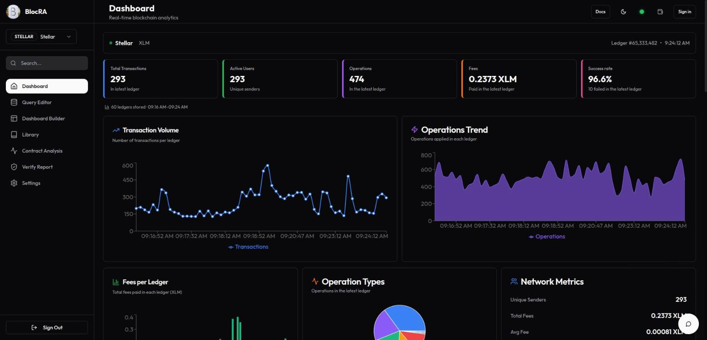
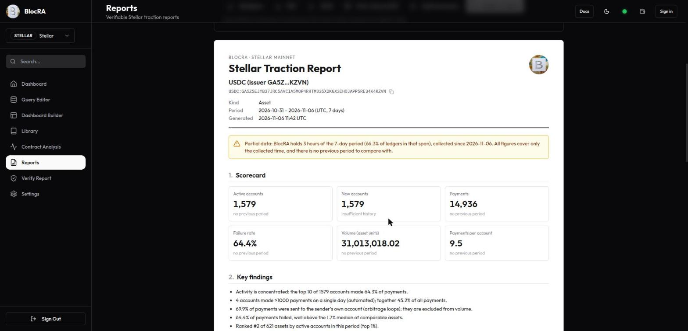
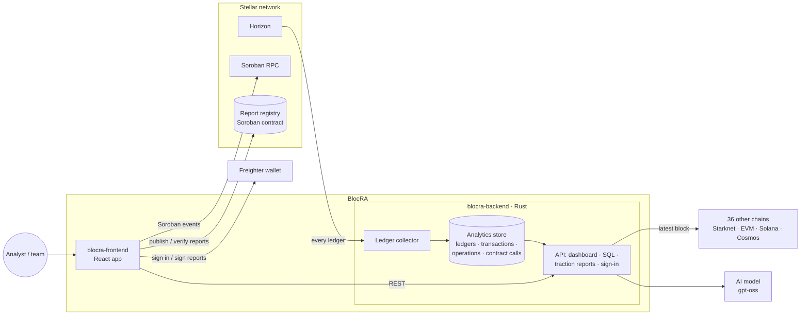

# BlocRA

**Blockchain analytics, built for Stellar.**

Explore live network activity, analyze smart contracts, query on-chain data, and publish reports anyone can verify.

  
   
  The network dashboard on Stellar mainnet: every ledger is collected, so the charts cover the last 60 ledgers from the first page load.

---

## What BlocRA does

BlocRA is an analytics platform built on Stellar. It collects every Stellar ledger, so its SQL,
dashboards and traction reports run on complete Stellar data, and reports can be verified on Stellar
itself. For comparison, the network dashboard and contract analysis also cover 36 other chains (EVM
networks such as Ethereum and Base, Solana, Starknet and Cosmos chains).

| Feature | Description |
|---------|-------------|
| **Network dashboard** | Live stats for 37 chains (transactions, failures, fees actually paid, transaction types), with history: every Stellar ledger is collected and stored |
| **Contract analysis** | Pulls a Soroban contract's events from Stellar RPC (EVM, Solana and Starknet contracts are supported too) and turns them into activity, user and volume analytics |
| **Query editor** | Real SQL over the data BlocRA collects (Stellar ledgers, transactions and operations, and sampled blocks from other chains), or describe what you want and let the AI write the query |
| **Dashboard builder** | Turn queries into number, line, bar, pie and table widgets; save dashboards to your account and export them as PNG or JSON |
| **AI analyst** | Chat, written contract reports, and natural-language-to-SQL, powered by any OpenAI-compatible model, including a self-hosted gpt-oss |
| **Traction reports** | 7- or 30-day reports on a Soroban contract or Stellar asset: active, new and returning accounts, failure rate, concentration and bot share, ecosystem rank, with coverage and methodology |
| **Verifiable reports** | Export a report as PDF, Markdown or JSON, publish its fingerprint on Stellar, and let anyone check that a copy is authentic and unmodified |
| **Stellar sign-in** | Sign in with a Freighter wallet by signing a one-time challenge (SEP-53); no password needed |

## Traction reports

Self-reported metrics are easy to inflate and hard to compare. A BlocRA traction report gives a
Soroban project or a Stellar asset independent numbers, computed from every ledger BlocRA collects,
with the method spelled out and a fingerprint anyone can check on Stellar.

**Who it is for**

- **Soroban teams and SCF grantees:** traction for grant milestones, investor updates and partners,
  instead of screenshots.
- **Asset issuers and anchors:** active senders, holders, supply across accounts, contracts and pools,
  and how much activity is real transfer rather than arbitrage loops.
- **Investors and grant reviewers:** comparable figures across projects, including how concentrated
  the activity is and how much of it comes from automated accounts.

  

**What every report contains**

| # | Section | Contents |
|---|---------|----------|
| 1 | Header | Subject (contract id or asset), network, period in UTC, generation time |
| 2 | Coverage notice | Shown when BlocRA holds less than the full period, with how much |
| 3 | Scorecard | Active accounts, new accounts, calls or payments, failure rate, volume (assets), activity per account, each with the change against the previous period |
| 4 | Key findings | Plain sentences derived by fixed rules from the figures; no model writes numbers |
| 5 | Activity | Active accounts, calls, failures and volume per day |
| 6 | Retention and user quality | Returning accounts, top-10 share, automated accounts (1,000+ actions on one day) and their share, self-payments (assets), top accounts |
| 7 | Contract functions / asset snapshot | Calls and failure rate per function; or holders and supply from Horizon |
| 8 | Ecosystem position | Rank by active accounts among every contract or asset active in the period, and the peers' median failure rate |
| 9 | Coverage and methodology | Ledger range, ledgers collected, completeness, and the definition behind each figure |
| 10 | Verification | The file's sha256 and its status in the on-chain report registry |

**Example findings** from a real report on USDC (Stellar mainnet, 3 hours of collected ledgers):

> - Activity is concentrated: the top 10 of 1631 accounts made 64.1% of payments.
> - 4 accounts made ≥1000 payments on a single day (automated); together 45.2% of all payments.
> - 69.7% of payments were sent to the sender's own account (arbitrage loops); they are excluded from volume.
> - 64.3% of payments failed, well above the 1.7% median of comparable assets.

Full samples, generated by BlocRA from mainnet data:
[USDC (asset)](https://github.com/Blocra-HQ/.github/blob/main/profile/samples/traction-report-usdc.md) ·
[most-used Soroban contract](https://github.com/Blocra-HQ/.github/blob/main/profile/samples/traction-report-contract.md).
They are marked partial because collection had only just started; a deployment that has been running
for the full period produces complete 7- and 30-day reports with period-over-period changes.

**Verify a copy:** export the report (PDF, Markdown or JSON), publish it on Stellar from your wallet,
and share the file. Anyone can drop it on BlocRA's Verify Report page, which hashes it in the browser
and shows who published it and when, or that it was changed.

## Repositories

| Repository | What it is | Stack |
|------------|-----------|-------|
| [**blocra-frontend**](https://github.com/Blocra-HQ/blocra-frontend) | The web app: dashboard, contract analysis, query editor, dashboard builder, report verification | React · TypeScript · Vite · Tailwind |
| [**blocra-backend**](https://github.com/Blocra-HQ/blocra-backend) | The API: network stats, wallet sign-in, saved queries and dashboards, AI analyst | Rust · Actix-web · SQLite |
| [**blocra-contracts**](https://github.com/Blocra-HQ/blocra-contracts) | The on-chain report registry that makes published reports verifiable | Rust · Soroban |
| [**blocra-research**](https://github.com/Blocra-HQ/blocra-research) | The verified chain registry and the RPC checker behind it | Python · JSON |
| [blocra-backend-legacy](https://github.com/Blocra-HQ/blocra-backend-legacy) | The original Node.js API, archived for reference | Node.js · Express · MongoDB |

## Architecture

- **Stellar pipeline (backend):** a collector reads every Stellar mainnet ledger from Horizon and
  stores it with its transactions, operations and decoded Soroban contract calls. The network
  dashboard, the history behind its charts, SQL in the Query Editor and Dashboard Builder, and the
  traction reports are all served from that store.
- **Backend services:** Stellar wallet sign-in (SEP-53), accounts, saved queries and dashboards, and
  the AI analyst (gpt-oss through any OpenAI-compatible endpoint). The other 36 chains get
  latest-block statistics from verified public RPCs.
- **Frontend:** the React app; it reads Soroban contract events from Stellar RPC for contract
  analysis and talks to the backend for everything else.
- **Report registry:** report hashes are published on Stellar from the user's wallet, so anyone can
  verify a copy. The registry runs on testnet as
  [`CD7UABTK…5CPW`](https://stellar.expert/explorer/testnet/contract/CD7UABTKAOO2EZ2A543GIIHQED6PPMIPK2NU47W5GKCRDJ26UPZ45CPW).

## Getting started

1. **Run the API:** follow [blocra-backend](https://github.com/Blocra-HQ/blocra-backend). It needs
   `JWT_SECRET`. AI is optional; point `AI_BASE_URL` / `AI_MODEL` at any OpenAI-compatible endpoint
   (Ollama works locally).
2. **Run the web app:** follow [blocra-frontend](https://github.com/Blocra-HQ/blocra-frontend) and set
   `VITE_BACKEND_URL` to the API.
3. **Deploy your own registry (optional):** follow
   [blocra-contracts](https://github.com/Blocra-HQ/blocra-contracts).

Issues and pull requests are welcome in each repository.
