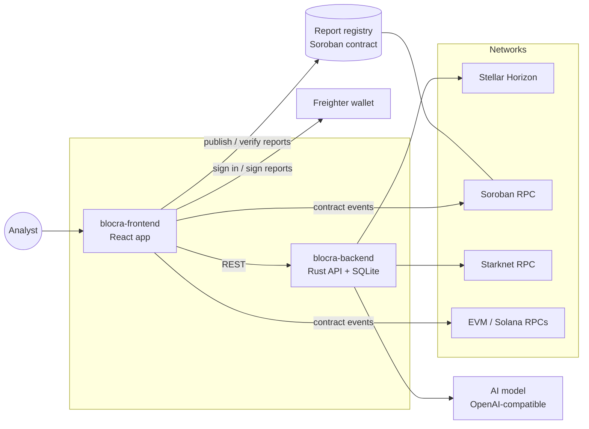

# BlocRA

**Blockchain analytics, built for Stellar.**

Explore live network activity, analyze smart contracts, query on-chain data, and publish reports anyone can verify.

---

## What BlocRA does

BlocRA is an analytics platform for on-chain data. **Stellar is the default chain**, and the same tools
work on 36 more networks, including Starknet, Ethereum and other EVM chains, and Solana.

| Feature | Description |
|---------|-------------|
| **Network dashboard** | Live stats from the latest Stellar ledger (via Horizon) or Starknet block: transactions, failures, fees actually paid, operation and transaction types |
| **Contract analysis** | Pulls a contract's events (Soroban contracts on Stellar, plus EVM and Starknet contracts) and turns them into activity, user, and volume analytics |
| **Query editor** | Write SQL over blocks, transactions and contracts, or describe what you want and let the AI write the query |
| **Dashboard builder** | Arrange charts and query results into dashboards you can share |
| **AI analyst** | Chat, written contract reports, and natural-language-to-SQL, powered by any OpenAI-compatible model, including a self-hosted gpt-oss |
| **Verifiable reports** | Export a contract report as PDF or DOCX, publish its fingerprint on Stellar, and let anyone check that a copy is authentic and unmodified |
| **Stellar sign-in** | Sign in with a Freighter wallet by signing a one-time challenge (SEP-53); no password needed |

## Repositories

| Repository | What it is | Stack |
|------------|-----------|-------|
| [**blocra-frontend**](https://github.com/Blocra-HQ/blocra-frontend) | The web app: dashboard, contract analysis, query editor, dashboard builder, report verification | React · TypeScript · Vite · Tailwind |
| [**blocra-backend**](https://github.com/Blocra-HQ/blocra-backend) | The API: network stats, wallet sign-in, saved queries and dashboards, AI analyst | Rust · Actix-web · SQLite |
| [**blocra-contracts**](https://github.com/Blocra-HQ/blocra-contracts) | The on-chain report registry that makes published reports verifiable | Rust · Soroban |
| [**blocra-research**](https://github.com/Blocra-HQ/blocra-research) | The verified chain registry and the RPC checker behind it | Python · JSON |
| [blocra-backend-legacy](https://github.com/Blocra-HQ/blocra-backend-legacy) | The original Node.js API, archived for reference | Node.js · Express · MongoDB |

## Architecture

- **Backend:** serves network stats from Horizon and Starknet RPC. It also handles wallet sign-in,
  saved queries and dashboards, and talks to the AI model.
- **Frontend:** reads contract events directly from public RPC nodes. Every endpoint it uses is
  verified in [blocra-research](https://github.com/Blocra-HQ/blocra-research).
- **Report registry:** reports are published on Stellar from the user's wallet. The registry runs on
  testnet as
  [`CD7UABTK…5CPW`](https://stellar.expert/explorer/testnet/contract/CD7UABTKAOO2EZ2A543GIIHQED6PPMIPK2NU47W5GKCRDJ26UPZ45CPW).

## Getting started

1. **Run the API:** follow [blocra-backend](https://github.com/Blocra-HQ/blocra-backend). It needs
   `JWT_SECRET`. AI is optional; point `AI_BASE_URL` / `AI_MODEL` at any OpenAI-compatible endpoint
   (Ollama works locally).
2. **Run the web app:** follow [blocra-frontend](https://github.com/Blocra-HQ/blocra-frontend) and set
   `VITE_BACKEND_URL` to the API.
3. **Deploy your own registry (optional):** follow
   [blocra-contracts](https://github.com/Blocra-HQ/blocra-contracts).

Issues and pull requests are welcome in each repository.
