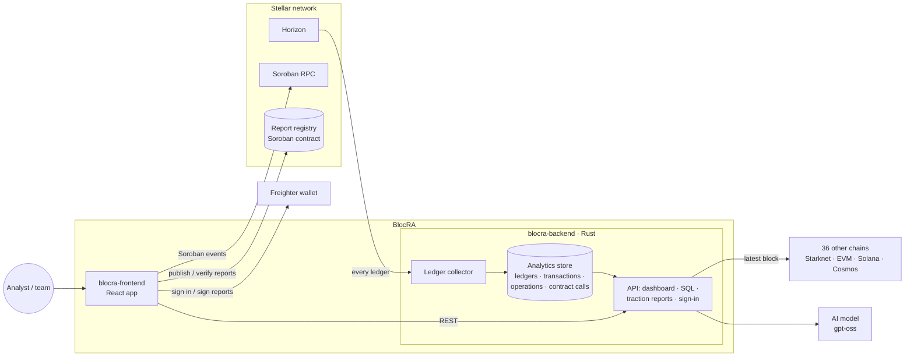

# BlocRA

**Blockchain analytics, built for Stellar.**

Explore live network activity, analyze smart contracts, query on-chain data, and publish reports anyone can verify.

  
   
  The network dashboard on Stellar mainnet: every ledger is collected, so the charts cover the last 60 ledgers from the first page load.

---

## What BlocRA does

BlocRA is an analytics platform built on Stellar. It collects every Stellar ledger, so its SQL,
dashboards and traction reports run on complete Stellar data, and reports can be verified on Stellar
itself. For comparison, the network dashboard and contract analysis also cover 36 other chains (EVM
networks such as Ethereum and Base, Solana, Starknet and Cosmos chains).

| Feature | Description |
|---------|-------------|
| **Network dashboard** | Live stats for 37 chains (transactions, failures, fees actually paid, transaction types), with history: every Stellar ledger is collected and stored |
| **Contract analysis** | Pulls a Soroban contract's events from Stellar RPC (EVM, Solana and Starknet contracts are supported too) and turns them into activity, user and volume analytics |
| **Query editor** | Real SQL over the data BlocRA collects (Stellar ledgers, transactions and operations, and sampled blocks from other chains), or describe what you want and let the AI write the query |
| **Dashboard builder** | Turn queries into number, line, bar, pie and table widgets; save dashboards to your account and export them as PNG or JSON |
| **AI analyst** | Chat, written contract reports, and natural-language-to-SQL, powered by any OpenAI-compatible model, including a self-hosted gpt-oss |
| **Verifiable reports** | Export a contract report as PDF or DOCX, publish its fingerprint on Stellar, and let anyone check that a copy is authentic and unmodified |
| **Stellar sign-in** | Sign in with a Freighter wallet by signing a one-time challenge (SEP-53); no password needed |

## Repositories

| Repository | What it is | Stack |
|------------|-----------|-------|
| [**blocra-frontend**](https://github.com/Blocra-HQ/blocra-frontend) | The web app: dashboard, contract analysis, query editor, dashboard builder, report verification | React · TypeScript · Vite · Tailwind |
| [**blocra-backend**](https://github.com/Blocra-HQ/blocra-backend) | The API: network stats, wallet sign-in, saved queries and dashboards, AI analyst | Rust · Actix-web · SQLite |
| [**blocra-contracts**](https://github.com/Blocra-HQ/blocra-contracts) | The on-chain report registry that makes published reports verifiable | Rust · Soroban |
| [**blocra-research**](https://github.com/Blocra-HQ/blocra-research) | The verified chain registry and the RPC checker behind it | Python · JSON |
| [blocra-backend-legacy](https://github.com/Blocra-HQ/blocra-backend-legacy) | The original Node.js API, archived for reference | Node.js · Express · MongoDB |

## Architecture

- **Stellar pipeline (backend):** a collector reads every Stellar mainnet ledger from Horizon and
  stores it with its transactions, operations and decoded Soroban contract calls. The network
  dashboard, the history behind its charts, SQL in the Query Editor and Dashboard Builder, and the
  traction reports are all served from that store.
- **Backend services:** Stellar wallet sign-in (SEP-53), accounts, saved queries and dashboards, and
  the AI analyst (gpt-oss through any OpenAI-compatible endpoint). The other 36 chains get
  latest-block statistics from verified public RPCs.
- **Frontend:** the React app; it reads Soroban contract events from Stellar RPC for contract
  analysis and talks to the backend for everything else.
- **Report registry:** report hashes are published on Stellar from the user's wallet, so anyone can
  verify a copy. The registry runs on testnet as
  [`CD7UABTK…5CPW`](https://stellar.expert/explorer/testnet/contract/CD7UABTKAOO2EZ2A543GIIHQED6PPMIPK2NU47W5GKCRDJ26UPZ45CPW).

## Getting started

1. **Run the API:** follow [blocra-backend](https://github.com/Blocra-HQ/blocra-backend). It needs
   `JWT_SECRET`. AI is optional; point `AI_BASE_URL` / `AI_MODEL` at any OpenAI-compatible endpoint
   (Ollama works locally).
2. **Run the web app:** follow [blocra-frontend](https://github.com/Blocra-HQ/blocra-frontend) and set
   `VITE_BACKEND_URL` to the API.
3. **Deploy your own registry (optional):** follow
   [blocra-contracts](https://github.com/Blocra-HQ/blocra-contracts).

Issues and pull requests are welcome in each repository.
